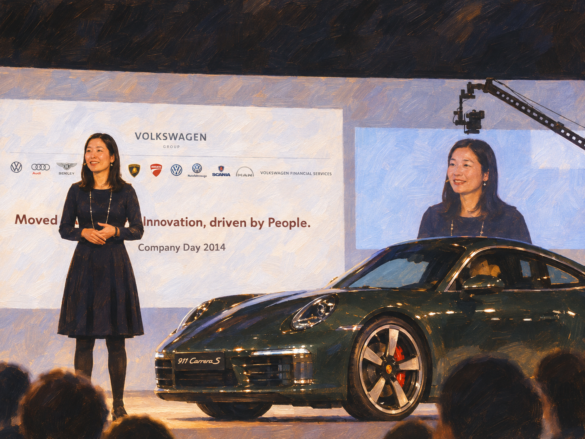
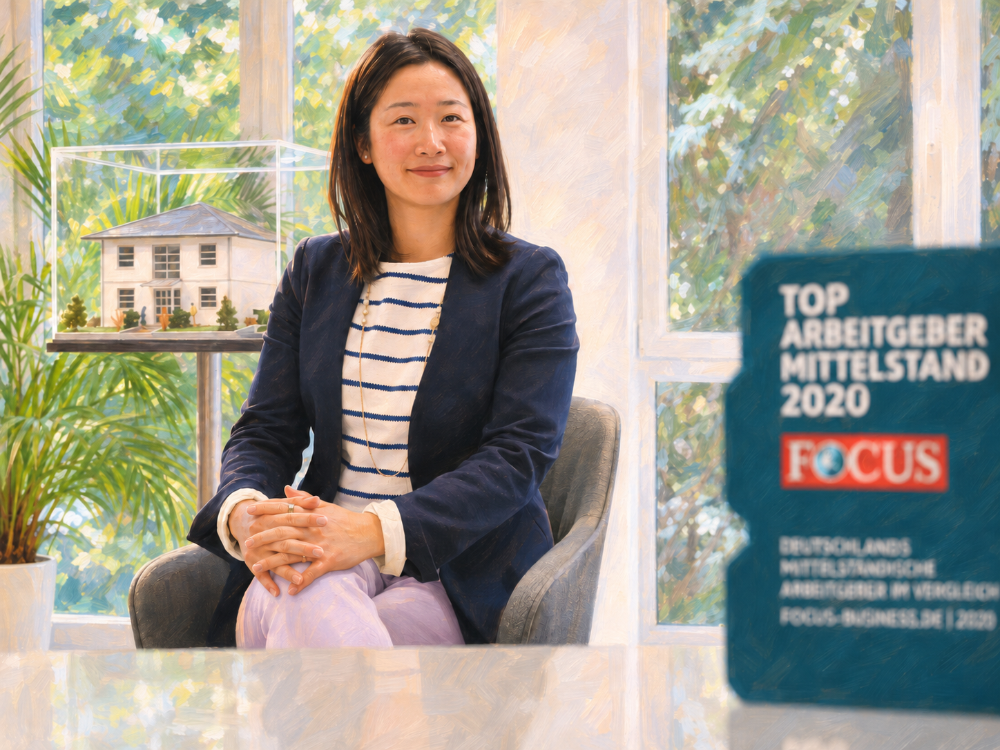

<!-- Stage 1: layout only. The previous text is preserved in
     content-archive/about-before-stage-1.md (not rendered as a web page). -->

::: {.about-intro}
[About Me]{.eyebrow}

# A journey shaped by people, curiosity, and unexpected turns. {.unlisted .unnumbered}

::: {.about-narrative}
I'm Jane Zhang. My journey has taken me across countries, cultures, and disciplines—from working with people and businesses to studying data science and artificial intelligence, and exploring the possibilities of our technological future through research and creative writing.

It hasn't been a straight path, nor one I could have planned entirely. Looking back, however, I can see how each experience has shaped the way I think, work, and understand the world.
:::
:::

<!-- Source order is always text, then visual. CSS alternates the desktop
     columns; on mobile, every stage reads as heading/text followed by image. -->

::: {.about-chapter .about-chapter--visual-first}
::: {.about-story}
## 01 — Where it began

[The Hutong, China]{.about-place}

::: {.about-narrative}
My professional journey began in China, at The Hutong, a cultural exchange organisation where I helped organise educational activities and corporate events.

Working with people from different cultural backgrounds taught me some of my earliest professional lessons: communication isn't simply about expressing yourself clearly, but also about understanding how differently others may see the same situation.

It was an environment where I learned to navigate different expectations, resolve misunderstandings, and appreciate the importance of working with people.
:::
:::

::: {.about-visual}
```{=html}
<figure>

  <figcaption>Working at The Hutong, China, 2014</figcaption>
</figure>
```
:::
:::

::: {.about-chapter .about-chapter--text-first}
::: {.about-story}
## 02 — Discovering data

[VW Financial Services China]{.about-place}

::: {.about-narrative}
I later joined Volkswagen Financial Services China, initially in administration before becoming an assistant to the HR director. I gradually took on responsibilities involving employee development and training.

Curious about whether our training programmes were genuinely effective, I began collecting feedback, analysing survey results, and sharing findings with colleagues to help improve the courses.

It was a modest introduction to data analysis, mostly using Excel. But I discovered something satisfying: data could help us look beyond impressions and better understand what was happening.

I didn't know it then, but that curiosity would eventually change my professional direction.
:::
:::

::: {.about-visual}
```{=html}
<figure>

  <figcaption>Porsche presentation on Group Company Day, 2014</figcaption>
</figure>
```
:::
:::

::: {.about-reflection}
::: {.about-reading}
## 03 — Starting again

[Germany]{.about-place}

::: {.about-narrative}
When my family moved to Germany, I expected to continue my career. Instead, I discovered how difficult it could be to begin again in a country where my previous experience didn't translate easily into new opportunities.

I first had to learn the language and find my footing in a different professional environment.

During this period, I participated in a career-support programme alongside women whose lives had taken very different, sometimes difficult paths. Listening to their experiences left a lasting impression on me. It made me more aware of how little we often know about the circumstances behind another person's life, and how differently opportunities can unfold.

My own turning point came unexpectedly. While helping at an education and employment fair, I met an HR director who noticed my work and offered me a position. I was grateful, but I had also begun thinking about changing direction. Instead of accepting the position as offered, I asked whether I could join the company's dual-study programme in business administration.

The answer was yes.

That decision opened a new chapter.
:::
:::
:::

::: {.about-chapter .about-chapter--visual-first}
::: {.about-story}
## 04 — From business to data science

[Germany]{.about-place}

::: {.about-narrative}
During my business studies in Germany, I became increasingly interested in statistics and data analytics. I began experimenting with company data, asking whether analytical methods could reveal patterns and relationships beyond conventional reporting.

Machine learning opened another dimension. Yet my undergraduate research also taught me a lesson I still value: a sophisticated model cannot compensate for data that is unsuitable for the question being investigated.

What began as a practical interest in using data to improve business decisions gradually developed into a desire to understand the methods and possibilities of data science more deeply.
:::
:::

::: {.about-visual}
```{=html}
<figure>

  <figcaption>Representing my employer for a workplace recognition award, Germany, 2020</figcaption>
</figure>
```
:::
:::

::: {.about-chapter .about-chapter--text-first}
::: {.about-story}
## 05 — Scientific inquiry

[University of Liverpool]{.about-place}

::: {.about-narrative}
After another family move, this time to Portugal, I decided to deepen my technical knowledge through an online MSc in Data Science and Artificial Intelligence at the University of Liverpool.

I completed the degree with distinction. For my dissertation, I explored physics-informed machine learning using space plasma data from the Solar Orbiter mission.

The research challenged me to work across scientific domains, confront unfamiliar problems, and recognise the importance of physical understanding alongside computational methods.

It strengthened my belief that meaningful analysis begins with understanding the problem, not simply choosing the most advanced model.
:::
:::

::: {.about-visual}
```{=html}
<figure>

  <figcaption>University of Liverpool graduation, 2025</figcaption>
</figure>
```
:::
:::

<!-- The concluding sections stack by default and sit side by side on wide screens. -->
::: {.about-closing}
::: {.about-reading}
::: {.about-closing-section #beyond-the-data}
## 06 — Beyond the data

::: {.about-narrative}
Alongside my technical studies, I became increasingly interested in the broader implications of artificial intelligence—not only what it might enable, but how it could influence human decisions, relationships, institutions, and society.

Creative writing became another way to explore those questions.

My published science-fiction novel, *Juan's World*, imagines possible technological futures through the experiences and choices of its characters. My completed manuscript, *Me and ChatGPT*, takes a different approach, examining personal experiences of human–AI interaction and the importance of understanding our emotional and cognitive responses to technology.

More recently, I've been developing an independent investigation into AI and energy systems, exploring how the growth of AI infrastructure interacts with electricity networks, regulation, environmental considerations, and the communities affected.

These are evolving areas of work, and I approach them with curiosity, evidence, and an appreciation for what I have yet to understand.
:::
:::

::: {.about-closing-section #approach-to-work}
## 07 — How I approach my work

::: {.about-narrative}
I enjoy exploring unfamiliar questions, working across disciplines, and exchanging perspectives with people from different backgrounds.

I believe imagination has a place in both scientific inquiry and creative writing. It helps us consider possibilities we might otherwise overlook. But when investigating real-world problems, those possibilities need to be examined against evidence, with care for assumptions, limitations, and uncertainty.

I also believe that meaningful work rarely happens in isolation. My own journey has depended not only on personal effort, but on people who shared their knowledge, recognised possibilities, and opened doors along the way.

Today, I live in Sweden, where I continue to develop my work in data science, creative writing, and independent research. I’m open to thoughtful conversations, interdisciplinary collaboration, and opportunities to explore worthwhile questions together.

This website is where I share that work, the thinking behind it, and the questions that remain.

And perhaps that is the most consistent part of my journey: not having all the answers, but continuing to learn how to ask better questions.
:::
:::
:::
:::
