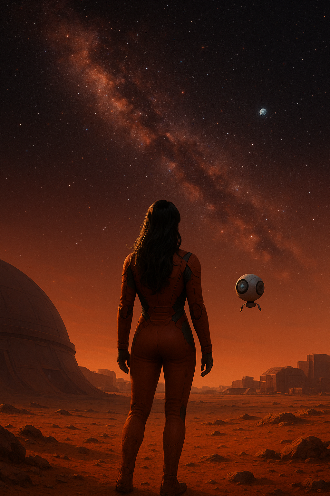
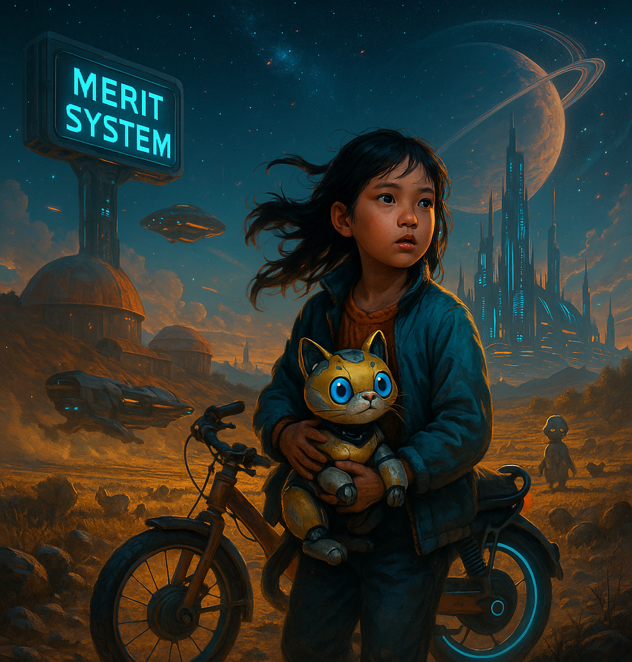
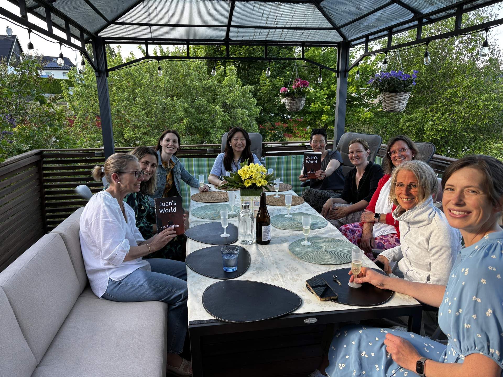

:::: {.book-opening}
::: {.book-opening-copy}
[Science Fiction · Published · Book One]{.work-type}

# Juan's World: In Relation {#book-title .unlisted .unnumbered}

[*Growing up in an extraordinary future.*]{.book-tagline}
:::

::: {.book-primary-artwork}
{width=1024 height=1536 fig-alt="Juan standing on the red surface of Mars beside a small hovering robot, beneath a star-filled sky." decoding=async}
:::
::::

## 01 — The Story {#the-story .book-chapter}

**A girl's journey into a future beyond Earth**

Humanity has ventured far beyond its home planet. Mars, the Moon and distant worlds are no longer merely destinations of imagination, but part of an expanding civilisation shaped by extraordinary technologies.

Yet not everyone shares equally in this progress.

Juan Chen grows up in a family with limited access to the technologies transforming society. Her father, a farmer struggling to keep pace with a changing world, makes a considerable sacrifice to give her an opportunity he never had: a neural biochip that opens the door to an entirely different future.

But that opportunity comes with demands Juan has not chosen for herself.

To prepare for life beyond Earth, she must undergo intensive training and physical transformation, encountering unfamiliar institutions, advanced technologies, unexpected friendships and difficult experiences along the way.

As Juan discovers the wonders of this remarkable civilisation, she also begins to question the expectations placed upon her and the future others have imagined for her.

*Juan's World* follows a young girl as she navigates the excitement, uncertainty, humour and emotional challenges of growing up in a world where almost anything seems possible.

::: {.book-story-illustration}
{width=632 height=662 fig-alt="Young Juan holding her robotic cat Mili beside a bicycle, with a futuristic city and a ringed planet in the background." loading=lazy decoding=async}
:::

## 02 — The Imagined World {#the-imagined-world .book-chapter}

**Where the extraordinary becomes everyday life**

Imagine a civilisation where vehicles hover above the ground through magnetic technologies, gardens float in midair, and clothing changes colour in response to human emotions.

Neural communication, holographic environments and advanced artificial intelligence are woven into daily life. Nanobots can transform human physical capabilities, preparing people to withstand conditions far beyond those found on Earth.

For Juan, this future is both fascinating and demanding.

Her training takes her through specialised facilities, including fusion centres, simulated planetary environments and programmes designed to prepare humans for interplanetary travel.

Artificial intelligences also have different roles in this civilisation. Some possess individual identities and are regarded as persons, while others remain sophisticated systems without sentience.

And beneath the apparent technological sophistication, mysteries remain. Unusual magnetic phenomena disturb parts of this world, raising questions that its inhabitants cannot yet fully explain.

The imagined technologies are not simply a futuristic backdrop. They shape the opportunities, relationships and difficulties that Juan encounters throughout her journey.

## 03 — Beneath the Wonder {#beneath-the-wonder .book-chapter}

**Familiar human experiences in an unfamiliar future**

Although the story takes place in a technologically advanced civilisation, its emotional world remains recognisably human.

Family relationships are complicated. Opportunities are unequal. Growing up involves difficult choices, misunderstandings, attachments and losses.

Juan's father's sacrifice offers her a path towards a different life, but it also introduces questions about freedom, expectation and the sacrifices made in the name of progress.

The novel explores how technology might transform human capabilities without necessarily resolving the inequalities and contradictions within society.

It also imagines different possibilities for coexistence between humans and artificial intelligence, while asking what responsibility and connection might mean in such a world.

Alongside these questions are moments of discovery, playfulness and wonder. Juan is still a young girl, encountering experiences that surprise, frustrate and delight her.

At its heart, the story is about growing up, finding one's place and confronting the unknown—even when the unknown lies among the stars.

## 04 — Behind the Story {#behind-the-story .book-chapter}

**How Juan's World began**

Before I began writing fiction, I had already spent time journaling about my own experiences, emotions and personal growth.

Over time, however, my curiosity began extending beyond those reflections.

While studying data science and artificial intelligence, I found myself surrounded by conversations about rapidly developing technologies, neural interfaces, artificial intelligence and humanity's ambitions in space. As someone who has always loved space, I could not help imagining what these possibilities might mean for our future.

Gradually, my thoughts became too expansive for a journal.

I began wondering what everyday life might look like in such a civilisation. And then another thought emerged: no matter how advanced humanity becomes, there may always be people who cannot access the same opportunities.

That was where the imagined future began to connect with a human story.

I did not start with a carefully planned novel. For some time, the ideas simply lived in my imagination. Eventually, one day, I opened a blank document and started writing.

My scientific interests also found their way into the fictional world. Studying solar wind and magnetic fields inspired mysterious magnetic anomalies, sometimes described through patterns resembling a heartbeat. In fiction, I could let that scientific fascination travel somewhere entirely imaginative.

*Juan's World* grew from this mixture of personal reflection, technological curiosity, human experience and my enduring fascination with space.

I wanted to imagine an extraordinary future without losing sight of the ordinary emotions, relationships and questions that make us human.

## 05 — Explore the Book {#explore-the-book .book-chapter}

**The beginning of Juan's journey**

*Juan's World: In Relation* is the first book in Juan's story.

Her journey continues beyond the events of Book One, with a second book currently in development.

**Available on Amazon**

[Find Juan's World: In Relation on Amazon](https://www.amazon.com/dp/B0FHKMCVHD){.text-link}

Readers may also search for the book through their local Amazon store.

## With readers {#with-readers .reader-memory}

::: {.readers-photo}
{width=1920 height=1440 fig-alt="Summer book-club gathering discussing Juan's World: In Relation." loading=lazy decoding=async}
:::

::: {.readers-copy}
One of the loveliest moments after publishing *Juan's World: In Relation* was sharing it with my book club.

It was a warm summer evening, and hearing other readers respond to Juan's story made the work feel newly alive to me.

Writing is often solitary. Moments like this remind me how meaningful it is when a story becomes something we can share, discuss and enjoy together.
:::

::: {.book-return-nav}
[← Return to Writing](../writing.qmd){.text-link .book-return}
:::
