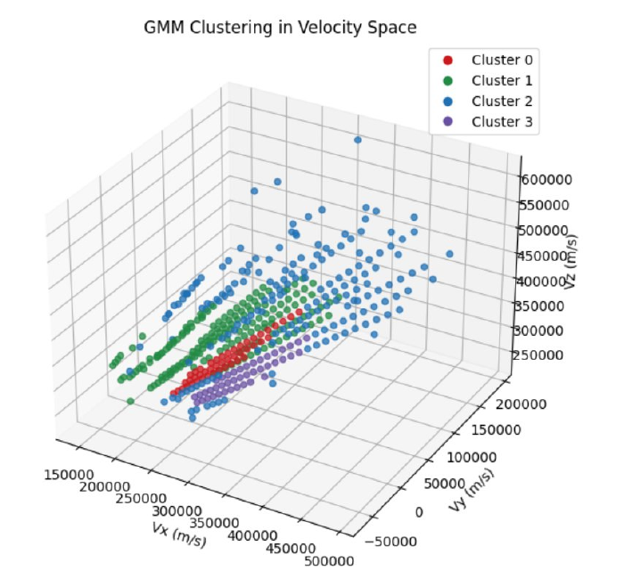

::: {.data-projects-intro}
## From questions to evidence

::: {.section-intro}
I enjoy using data science to investigate complex problems, discover meaningful patterns, and test possible explanations.
:::

My approach begins with understanding the problem and the nature of the data, rather than selecting models for their complexity. I value methodological rigour, interpretability, and the integration of domain knowledge.

Here, I share selected research and technical projects, including their methods, findings, limitations, and the lessons learned along the way.
:::

::::: {.portfolio-entry}
## Featured Project

:::: {.featured-research}
::: {.research-copy}
[MSc Research · 2025 | Software Extension · 2026]{.work-type}

### Physics-Informed Machine Learning in Space Plasma Physics

*Scientific Machine Learning · Solar Orbiter · Python*

My MSc dissertation at the University of Liverpool investigated how physics-informed machine learning could help us understand the complex dynamics of the solar wind using real spacecraft observations.

The research combined Gaussian Mixture Models (GMM), HDBSCAN clustering, and Sparse Identification of Nonlinear Dynamics (SINDy) to investigate particle populations, plasma regimes, and their temporal evolution.
:::

::: {.research-visual}
<!-- Original Figure 20, dissertation page 56 (PDF page 61); extracted without changing the plotted data. -->
{width=480 fig-alt="Three-dimensional velocity-space scatterplot from the MSc dissertation, showing GMM clusters 0 to 3 in red, green, blue, and purple, with velocity axes measured in metres per second."}
:::
::::

::: {.research-extension}
After completing the dissertation, I revisited the research to explore how notebook-based experimentation could be developed into more structured, reusable, and reproducibility-oriented scientific software.

This extension involved modularising the analytical pipeline, introducing automated tests, and documenting the workflow, alongside further scientific investigation.

[Explore the project →](projects/msc-space-plasma.qmd){.text-link}

[View code and documentation on GitHub](https://github.com/Jane-bunny/solarwind-multiscale){.text-link}
:::
:::::
